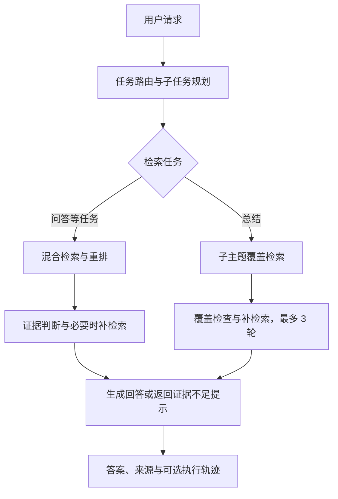

# Course RAG Agent

基于 RAG 与任务型 Agent 的中文课程学习助手，支持上传 PDF、Markdown 和 TXT，围绕课程资料进行**问答、知识总结、练习生成与答案批改**。

本项目来自中文信息处理课程期末实践，已实现文档入库、混合检索、任务编排、带来源的回答和评测工具，可在本地运行演示。

[快速开始](#快速开始) · [系统流程](#系统流程) · [评测与验证](#评测与验证) · [技术文档](#技术文档)

## 项目亮点

| 能力 | 实现 |
| --- | --- |
| 文档处理 | 接入 MinerU 解析 PDF，保留页码、块坐标与标题上下文，显示解析质量提示 |
| 混合检索 | FAISS 向量检索与 BM25 分数归一化加权融合，使用 CrossEncoder 重排 |
| Agent 编排 | 任务路由、复合请求拆解、证据充分性判断与补检索；总结任务最多进行 3 轮覆盖式检索 |
| 多轮交互 | 保存会话历史，以任务状态摘要压缩较早对话，并管理跨会话长期记忆 |
| 工程支持 | FastAPI 接口、SSE 流式输出、规则回退、解析缓存与失败诊断，可通过 AgentTrace 查看执行过程 |
| 评测工具 | 检索证据评测与人工审核，以及真实 Agent 单轮流程评测，支持断点续跑和结果导出 |

前端采用 HTML、原生 JavaScript 和 CSS，由 FastAPI 静态托管；元数据、会话与记忆存储在 SQLite，向量索引使用 FAISS。

## 使用场景

上传相关课程资料后，可以在页面中选择任务类型，或使用自动模式：

| 场景 | 输入示例 |
| --- | --- |
| 课程问答 | “CRF 和 HMM 的区别是什么？请结合资料解释。” |
| 知识总结 | “总结中文分词的主要方法、优缺点和适用场景。” |
| 复合任务 | “总结 HMM 和 CRF 的区别，并围绕它们出三道题。” |
| 答案批改 | “题目：CRF 和 HMM 有什么区别？我的答案：HMM 是生成式模型，CRF 是判别式模型。” |

回答可附带检索来源；证据不足时会补检索，或按当前规则提示无法充分回答。以上是交互示例，实际结果取决于上传资料和模型输出。

## 系统流程

聊天接口与流式接口共用 [AgentService](backend/app/core/agent_service.py)。下图展示基于资料的主要处理路径；会话上下文与记忆在调度前后由记忆模块管理。



- **路由与规划**：显式指定问答、总结、出题或批改时优先遵循用户选择；自动模式下由 LLM 判断任务、改写 query，并按需拆分复合请求。
- **检索与证据**：[HybridRetriever](backend/app/retrieval/retriever.py) 结合向量与关键词召回；问答偏向精确证据，总结兼顾主题覆盖和来源多样性。
- **失败处理与追踪**：Router、Planner、EvidenceJudge 调用失败或结果无法解析时提供规则回退；可通过 AgentTrace 检查路由、检索、证据判断及工具调用。

## 快速开始

以下命令使用 **Windows PowerShell**，从仓库根目录运行。后端使用独立 Python 3.10 环境；MinerU 的 PDF 解析环境需另外安装。

### 1. 安装后端依赖

```powershell
git clone https://github.com/ArcB1213/NLP-Course-Final-Project.git
cd NLP-Course-Final-Project
conda create -n course-rag-agent python=3.10 -y
conda activate course-rag-agent
cd backend
pip install -r requirements.txt
Copy-Item .env.example .env
```

### 2. 配置模型

编辑 `backend/.env`，填入可用的 API 密钥：

```env
DEEPSEEK_API_KEY=your_api_key_here
DEEPSEEK_THINKING=false
```

模型名、服务地址及其他选项见 [配置示例](backend/.env.example)。不要提交包含真实密钥的 `.env`。

首次使用先上传 Markdown 或 TXT 即可体验主要流程。**上传 PDF 前，需按 [文档解析与质量检查](docs/document-processing.md) 安装独立的 MinerU 环境与标准版模型**；默认配置下未安装会明确报错。

PDF 的标题判定默认调用文本 LLM，会发送候选文字、位置坐标和短正文；如需仅在本地解析 PDF，可设置 `PDF_TITLE_RESOLUTION=false`。这不会关闭聊天与评测的外部模型调用。

### 3. 启动服务

继续在 `backend` 目录中运行：

```powershell
python run.py
```

| 入口 | 地址 |
| --- | --- |
| 学习助手 | http://localhost:8000/ |
| 检索评测与审核 | http://localhost:8000/evaluation.html |
| Swagger API 文档 | http://localhost:8000/docs |
| 健康检查 | http://localhost:8000/api/health |

在左侧上传资料，中间输入问题，右侧选择任务类型、top_k 或 Pro 模型。支持流式回答、历史会话和深浅主题切换。

单文件默认上限为 100 MB。首次检索会下载 embedding / reranker 模型，首次 PDF 解析也可能需要较长时间。

## 评测与验证

项目提供不同层次的验证入口，避免把功能测试或机器评分当作实际回答准确率：

| 层次 | 验证内容 | 入口 |
| --- | --- | --- |
| 自动化回归 | 解析、分块、缓存、失败处理、会话、记忆与评测模块等行为 | `backend/tests/` |
| 检索评测 | 从资料出题、执行真实检索、模型预标注、引文核对与人工审核；机器标签和人工标签分开统计 | [检索评测说明](docs/retrieval-evaluation.md) |
| 单轮系统评测 | 调用与聊天 API 相同的 Agent 流程，评审答案相关性、证据支持和关键点覆盖，并记录耗时与轨迹 | [系统评测说明](docs/system-evaluation.md) |

运行自动化回归：

```powershell
# 在 backend 目录中运行
python -m pytest -q
```

测试不代表公式识别或回答准确率；部分真实图片渲染测试需要独立 MinerU 环境，未安装时跳过。系统评测针对独立单轮问题，关闭会话记忆，不覆盖多轮记忆、HTTP/SSE 传输或浏览器性能。LLM 辅助评分也不等同于经过人工校准的正确率。

## 核心目录

| 路径 | 职责 |
| --- | --- |
| [backend/app/core/](backend/app/core/) | Agent 编排、路由、规划、证据判断、模型调用与记忆 |
| [backend/app/document/](backend/app/document/) | 文档解析、标题处理、分块和入库 |
| [backend/app/retrieval/](backend/app/retrieval/) | 向量索引、BM25、混合检索和重排 |
| [backend/app/tools/](backend/app/tools/) | 问答、总结、出题与批改 |
| [backend/app/evaluation/](backend/app/evaluation/) | 检索及系统评测 |
| [backend/tests/](backend/tests/) | 自动化回归测试 |
| [frontend/](frontend/) | 学习助手与评测审核页面 |
| [docs/](docs/) | 安装、使用、实现边界和评测说明 |

## 当前局限与后续方向

- 复杂公式、表格仍需人工核对；示意图中的关系尚未完整转为可检索的文字证据。
- 公式与说明分开后可能漏召回；尚未完成语义分块、相邻片段扩展或完整章节树。
- 长期记忆与自动批改仍依赖模型判断，需要结合真实样例审核；现有单轮系统评测不能证明多轮记忆效果。
- 后续重点包括章节级 / Parent-Child 检索，以及 Quiz / Grade 专用检索策略与相应效果评测。

## 技术文档

- [文档解析与质量检查](docs/document-processing.md)：MinerU 安装、标题判定、缓存、重解析与排错。
- [会话历史与摘要](docs/conversation-memory.md)：摘要配置、上下文保留、历史会话与旧数据兼容。
- [长期记忆形成与人工核对](docs/memory-formation-review.md)：写入依据、证据门槛及人工验收情形。
- [检索配置与接口调试](docs/usage-and-debugging.md)：检索参数、AgentTrace 和 PowerShell 调用示例。
- [API 说明](docs/api.md)：上传、检索、聊天和流式接口。
- [检索评测](docs/retrieval-evaluation.md) / [系统评测](docs/system-evaluation.md)：运行步骤、统计口径和结果导出。

